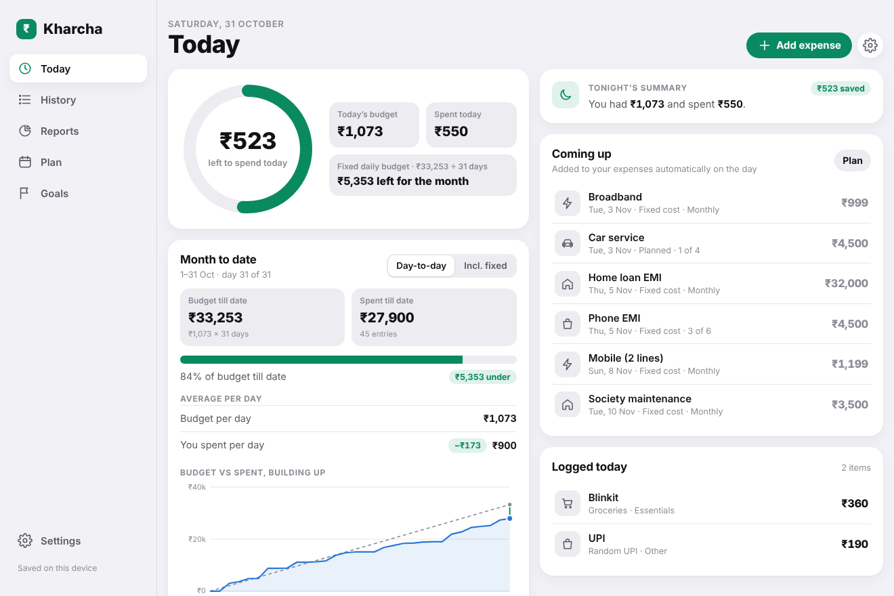
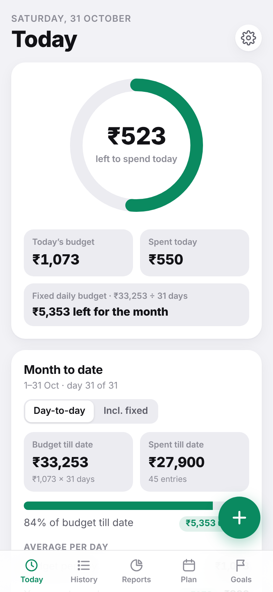
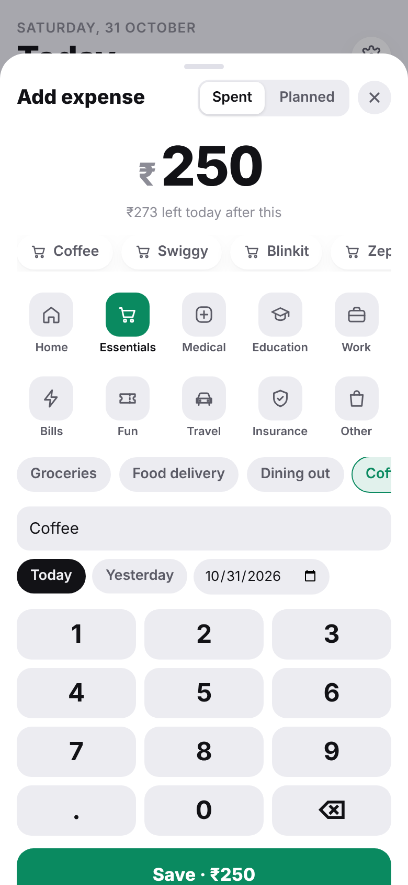
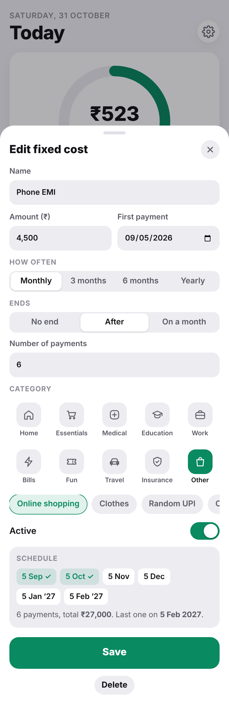
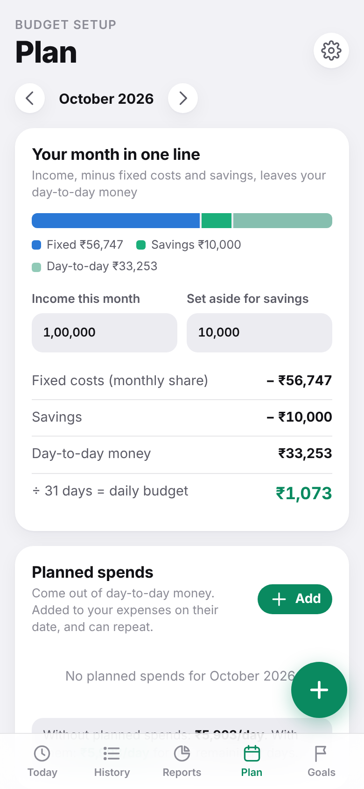
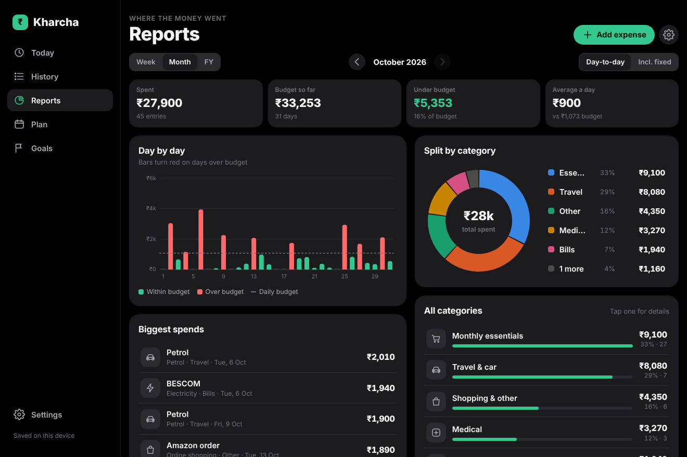

# Kharcha

**A daily budget app for India. It tells you how much you can spend today, and every night it tells you how you did.**

On a ₹1,00,000 salary, the money is mostly gone before the month is. Kharcha takes your income, removes EMIs, fees and savings first, and divides what's left by the days in the month. Every rupee you log comes out of today's budget, so you can see where the money is going while there's still time to change it.

**[Try the demo →](https://YOUR-USERNAME.github.io/kharcha/)** It opens with sample data and saves only in your browser. No sign-up needed.



<p>
  
  
  
  
</p>

## Why I built it

I watched a reel where someone broke a ₹1 lakh salary down to ₹3,333 a day, and showed how coffee, Blinkit, Zepto and Swiggy eat that by 6 PM. He asked Indian developers to build an app that tells you every night how you did with money that day.

I'm not a developer. I'm a program director, and I built this with an AI assistant (Claude), working the way I'd run a delivery: requirements, wireframes, review, test, release. I use it every day for my family's spending.

## What it does

- **Daily budget after fixed costs.** Income, minus EMIs, school fees, bills and savings, divided by the days in the month.
- **Three-tap logging.** Amount, category, save. Your most frequent spends (Swiggy, petrol, coffee) appear as one-tap shortcuts.
- **Recurring costs that post themselves.** EMIs, rent, school fees, insurance and subscriptions are added to your expenses on their due date. Set them to end after a number of payments or in a given month, so a 6-month EMI stops on its own.
- **Planned spends.** Add a car service or a gift ahead of time to see what's left per day for the rest of the month.
- **Month to date.** Budget till date vs spent till date, your average per day vs your budget per day, and a chart of both through the month.
- **Reports.** Week, month or financial year (April to March), a category split, and the days you went over.
- **Goals.** How much to save each month to reach a target, and when you'll actually get there at your current rate.
- **Works on phone and laptop**, with light and dark mode. On iPhone, add it to your Home Screen and it opens like an app.



## Run your own copy

The whole app is one file, `public/index.html`. It has two modes:

| Where it runs | Sign-in | Where data lives |
|---|---|---|
| Any static host or opened as a file (like the demo) | None | That browser only |
| Firebase Hosting | Google sign-in | Your own Firebase project, synced across your devices |

To host your own synced copy on Firebase's free plan:

1. **Fork** this repository, then create a project at [console.firebase.google.com](https://console.firebase.google.com).
2. In that project, turn on **Authentication → Sign-in method → Google**, and create a **Firestore Database** in production mode.
3. Install the Firebase tool (needs [Node.js](https://nodejs.org)) and deploy:
   ```
   npm install -g firebase-tools
   firebase login
   firebase deploy --project YOUR-FIREBASE-PROJECT-ID
   ```
4. Open `https://YOUR-FIREBASE-PROJECT-ID.firebaseapp.com` and sign in with Google.

The Firebase settings are read from the hosting environment, so there are no keys in the code. `firestore.rules` makes sure each person can read and write only their own data.

## How it's built

- One HTML file with plain JavaScript and CSS. No framework and no build step.
- Firebase Authentication (Google) and Cloud Firestore, with offline support.
- GitHub Actions deploys to Firebase and to the GitHub Pages demo whenever `public/` changes. That means I can ship an update from my phone.

## What's next

- A nightly "how did you do today" notification
- Net worth: what you have, what you owe, what you're aiming for
- A simple setup guide for first-time users

Ideas and bug reports are welcome. Open an [issue](../../issues).

## License

[MIT](LICENSE). Use it, change it, share it.
